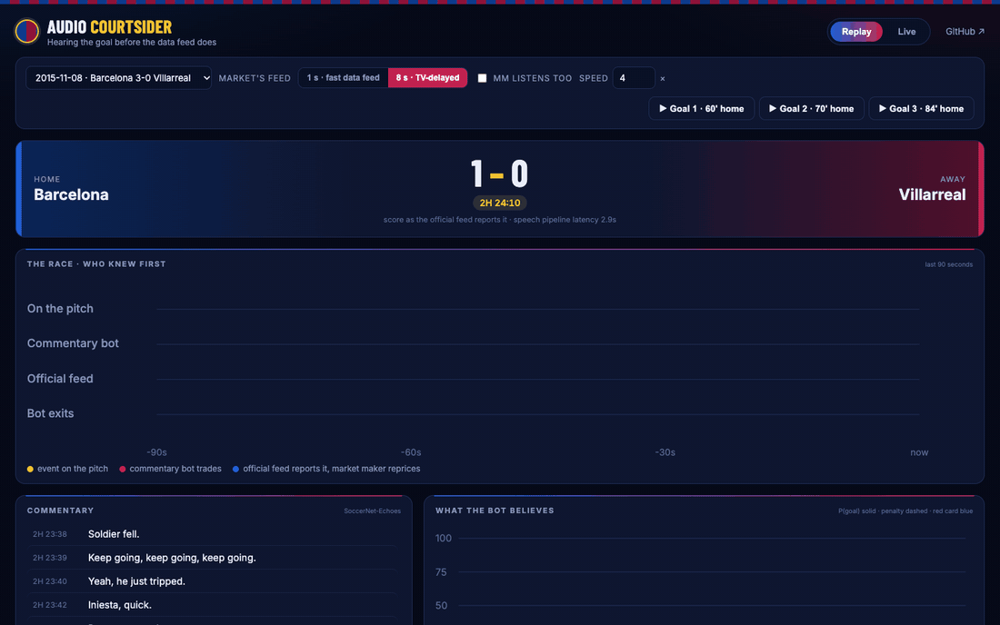
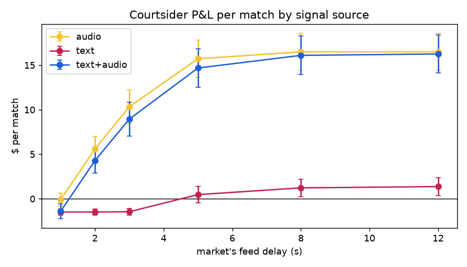
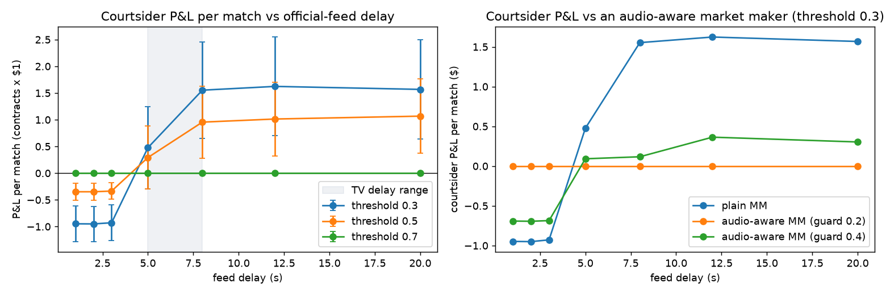
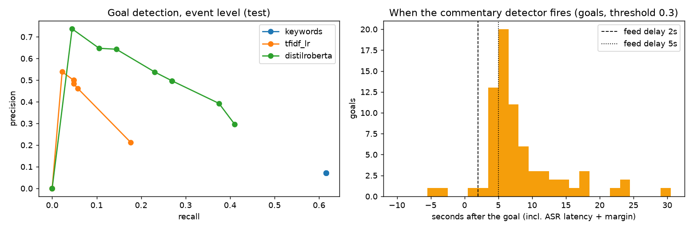

# Audio Courtsider

**Hearing the goal before the data feed does.** A real-time system that listens to soccer
commentary, works out what just happened on the pitch, and trades on that head start in a
simulated in-play exchange — then measures how much the edge is worth and whether a market maker
can defend against it.

**[▶ Live demo](https://srishti-h.github.io/audio-courtsider/)**: replay real goals in the browser and flip the
market's feed delay to watch the edge appear or vanish.



## Results

All numbers are on held-out data: SoccerNet **test** split (92 matches with commentary, 75 with
odds for trading). Thresholds and model choices were made on the validation split.

**Headline: listen to the crowd, not just the words.** A small causal network trained on the
broadcast audio of 500 matches hears a goal a median **2.4 s** after it happens (67 % of goals,
62 % precision, ~1 false alarm per match). Trading on it earns **+$5.6 per match against a market
2 s behind the broadcast and +$15.7 at 5 s**, versus −$1.0 and +$0.5 for commentary text alone:

| market's feed delay (behind the broadcast) | 1 s | 2 s | 3 s | 5 s | 8 s | 12 s |
|---|---|---|---|---|---|---|
| bot on commentary text ($ / match) | −0.95 | −0.95 | −0.93 | +0.48 | +1.55 | +1.62 |
| **bot on the learned audio detector** | −0.10 | **+5.60** | **+10.32** | **+15.72** | **+16.49** | **+16.50** |
| bot on text + audio | −0.91 | +4.80 | +9.43 | +15.09 | +16.40 | +16.45 |

(±$2 standard error across the 75 matches for the audio rows, ±$0.3–0.9 for text.) Adding text to
audio barely helps: its extra false alarms cost about as much as its extra catches earn. Text rows
use the text model refreshed with 2025/26 data (see *Recent data* below).



**0. Hearing goals faster** (detection on the test split; time after the labelled goal):

| detector | data | goals caught | median delay | false alarms / min |
|---|---|---|---|---|
| commentary text, confirmed sentences | 30 goals, real broadcast audio | 37 % | 8.1 s | 0.11 |
| commentary text, **fast path** (0.5 s step, scores unconfirmed words) | same | 70 % | 3.2 s | 0.23 |
| hand-built crowd-roar rule | 30 goals, real audio | 23 % | 0.6 s | 0.22 |
| **learned audio goal detector** (causal TCN on log-mel) | 309 goals, 188 halves | **67 %** | **2.4 s** | **0.015** |
| same detector, lower threshold (0.2) | same | 85 % | 1.1 s | 0.087 |

**1. Commentary is worth money only against a slow market.** A courtsider that hears the
commentary trades against a market maker who reprices on the official feed. P&L per match over the
same 75 test matches:

| market's feed delay behind the pitch | 1–3 s | 5 s | 8 s | 12 s | 20 s |
|---|---|---|---|---|---|
| courtsider P&L ($ / match) | −0.95 ± 0.33 | +0.48 ± 0.77 | +1.55 ± 0.90 | +1.62 ± 0.92 | +1.57 ± 0.93 |
| gain vs a 1 s feed (paired) | – | **+1.42 ± 0.75** | **+2.50 ± 0.87** | **+2.57 ± 0.90** | **+2.52 ± 0.96** |

Against a fast (≤3 s) data feed the courtsider *loses* money: commentary usually confirms a goal
after the price has already moved, so its only trades are false alarms (~0.5 per match), each
costing the spread. The edge switches on at ~5 s, i.e. against books priced off TV pictures
(5–8 s behind) or streams. The courtsider ignores commentary about an event the feed has already
published in the last 45 s, so a late "goal!" is never mistaken for a second goal.



**2. A market maker can defend cheaply, but the bigger threat is the TV.** If the market maker
runs the same commentary detector and pulls quotes when P(event) ≥ 0.4, it cuts its losses to
the courtsider by $1.07–1.10 per match at a cost of only $0.19–0.23 of spread revenue; at 0.2 it
shuts the courtsider out entirely for $0.45–0.52. For comparison, once its feed is slower than TV
viewers (7 s), slow-but-informed TV traders cost it **$46 ± 4 per match**.

**3. Detecting events from (noisy, mostly machine-translated) commentary text** — event level,
test split, with measured ASR latency (1.83 s) and a conservative 1.05 s timestamp margin added:

| event | n | precision | recall | median time after the event |
|---|---|---|---|---|
| goal | 312 | 0.54 | 0.23 | 6.4 s |
| yellow card | 397 | 0.54 | 0.54 | 5.1 s |
| offside | 389 | 0.61 | 0.46 | 5.6 s |
| corner | 927 | 0.44 | 0.39 | 3.7 s |
| substitution | 533 | 0.50 | 0.35 | 3.1 s |
| penalty | 37 | 0.17 | 0.05 | −2.5 s (called as it is awarded) |
| red card | 21 | 0.33 | 0.10 | 11.1 s |

For goals, the fine-tuned DistilRoBERTa beats TF-IDF + LR (P 0.21 / R 0.18) and keyword rules
(P 0.07 / R 0.62: "goal" is said all the time) and its isotonic-calibrated probabilities are
well calibrated (ECE 0.001 vs 0.030 raw). An HMM filter trades precision for recall (P 0.13 / R
0.50). Team attribution on confident goal calls: 62 %. Red cards were undetectable (0 of 21) until
the 2025/26 ESPN data was added; they are still the weakest class.



**4. Streaming speech recognition on an M5 Pro** (synthetic commentary audio — real Echoes text
re-voiced over a synthetic crowd; 16 clips, 24 min):

| Whisper | team-sheet biasing | WER | player-name recall | median word latency | real-time factor |
|---|---|---|---|---|---|
| tiny | – | 0.65 | 0.27 | 1.8 s | 0.08 |
| base | – | 0.59 | 0.28 | 1.9 s | 0.15 |
| small | – | 0.32 | 0.37 | 2.4 s | 0.22 |
| **small** | **✓** | **0.25** | **0.73** | **2.1 s** | 0.20 |
| large-v3-turbo | ✓ | 0.44 | 0.73 | 2.5 s | 0.79 |

Biasing the decoder with names mined from the match doubles player-name recall. Turbo runs near
real time, so its lag spikes (p99 15 s); `small` + biasing is the operating point. Crowd-roar
onsets, when they fire, land 0.5 s after the goal vs ~4.6 s for the transcript path (33 % recall,
synthetic crowd).

**5. On real broadcast audio, end to end** (5 test matches with English commentary, 458 min,
30 goals; SoccerNet videos under NDA, streamed through Whisper `small` + name biasing, the text
model and the crowd detector):

| signal | goals caught | median time after the goal | false alarms |
|---|---|---|---|
| commentary text (P ≥ 0.5) | 27 % | 6.7 s | 0.05 / min (≈ 4 per match) |
| crowd roar (CUSUM) | 23 % | **0.6 s** | 0.22 / min (≈ 19 per match) |
| either | 43 % | | |

Live speech-to-text on broadcast audio delivers a commentary segment 2.4 s after it is spoken at
0.39× real time. The text path's timing on real audio (27 % at 6.7 s) matches the transcript-based
estimate above (25 % at 6.1 s), which supports the offline methodology; the crowd reacts an order
of magnitude faster than the words, but is noisy on its own.

**6. Pricing and plumbing.** Dixon–Coles fit only on earlier matches gets a 1X2 log loss of 0.989
on 5,478 matches, closing 73 % of the gap between base rates (1.063) and Pinnacle closing odds
(0.962); in-play Brier falls from 0.50 at kick-off to 0.14 at 85'. The pure-Python matching
engine handles 350 k msgs/s (p50 2.3 µs, p99 7.8 µs); the text classifier scores a segment in
3.4 ms on MPS; acoustic features cost 11 ms per second of audio.

## Recent data (2025–26)

SoccerNet stops in 2017, so `make refresh` (rerun after match weekends) brings in current data:

* **Results and odds through 2026/27** (football-data.co.uk). Scored the same out-of-sample way on
  3,801 matches from 2024–26, Dixon–Coles stays as close to Pinnacle's closing odds as on 2014–17
  (log loss 1.000 vs 0.970, against 0.989 vs 0.962). The Live tab shows its pre-match prices.
* **ESPN's written play-by-play for every 2025/26 match in the five leagues** (2,047 matches,
  229 k lines, 5.8 k goals, 1.3 k penalties, 400 red cards; `data/espn.py`). The text model is
  fine-tuned on it from the current weights, mixed 1:1 with a replay sample of SoccerNet so it keeps
  the spoken style, and kept only if SoccerNet validation does not get worse:

  | text model, SoccerNet test | before | **with 2025/26 data** |
  |---|---|---|
  | goal calls, precision (event level) | 43 % | **54 %** (recall 25 % → 23 %) |
  | red cards caught | 0 % | **10 %** (33 % precision) |
  | segment avg. precision: goal / penalty / red card | 0.080 / 0.018 / 0.012 | **0.082 / 0.029 / 0.023** |
  | text bot vs a 1 s feed ($ / match) | −1.48 | **−0.95** |

* **Live Spanish radio recorded by the background recorder, labelled automatically** (`data/radio.py`).
  Radio arrives later than the action, so each station's delay is estimated as the shift that lines
  up ESPN's goal times with goal calls in the transcript; segments are then labelled like SoccerNet's.
  Sessions are split by date (latest 30 % held out). The recorder also logs log-mel features (never
  audio) so the audio goal model retrains on radio (`goal_model --radio`) once 30+ goals are logged.
  So far: one Champions League night, 22 min, 3 goals; on it the refreshed text model raises
  3× fewer false alarms (0.05/min vs 0.14) with the same recall (1 of 3). Too small to quote as a
  result yet; it grows every match day.

## Live mode: point it at a real match

The local dashboard has a **Live** tab. Pick a match from the live-score feed (ESPN's public
scoreboard, polled every 5 s; or set `FOOTBALL_DATA_TOKEN` to use football-data.org), then give it
audio: a **browser tab** streaming the game, your **microphone** near a TV or radio, or a saved
**audio file**. In real time it shows:

* the streaming transcript (Whisper `small`, biased with the **real lineups** from the feed),
* P(goal / penalty / red card) and which team, plus the crowd-roar level,
* every detection, and when the feed reports a goal, **how many seconds the commentary beat it by**.

**Unattended Spanish radio.** `python -m courtsider.live.recorder` (or `scripts/recorder_agent.sh
install` to run it in the background) watches ESPN for live La Liga and Spanish-club European
matches and, while one is on, streams Cadena SER's commentary through Whisper translating Spanish to
English, with both lineups as vocabulary, and logs detections against the live feed. First live
session (Champions League, 13 Oct 2026): Villarreal's goal vs Napoli was called on air and flagged
**15.8 s before ESPN's feed**; the stream dropped for most of that night (the recorder now
reconnects automatically) and multi-match radio produces more false alarms than single-match TV.

Sessions are logged to `data/live/` (text and detections only, no audio). Then
`python -m courtsider.live.report` summarises lead times across every match you've listened to
(`results/live.json`). Text play-by-play sites (FotMob, ESPN) aren't used as live "commentary": their
text is generated from the same data feed, so it can never be ahead of it. ESPN's play-by-play is
used only as training data for the text model (see *Recent data*).


```
 commentary audio ──► streaming Whisper (mlx, LocalAgreement-2, team-sheet biasing) ─┐
        │                                                                               ├─► text event extractor ──► calibration / fusion ──► P(goal | team), P(penalty), P(red)
        └──► crowd-roar CUSUM + commentator excitement (pitch, loudness) ─────────────┘                                                    │
                                                                                                                                             ▼
 SoccerNet true events ──► official feed (t + delay) ──► Dixon–Coles in-play pricer ──► market maker  ◄──── courtsider bot (trades the gap)
                                                                                              │                     ▲
                                                             noise traders, TV-delay traders ─┴──► EXCHANGE ◄───────┘
                                                                         (price-time order book, risk checks, journal)
```

| Stage | What | Key ideas |
|---|---|---|
| **Data** (`data/`) | 500 SoccerNet matches: 110k timestamped events, 714k commentary segments (464 matches with English text), 5.5k matches of results + closing odds | event labels and commentary share the broadcast timeline, so text can be supervised by *when* things happened |
| **Speech** (`asr/`) | streaming Whisper on Apple silicon | re-transcribe a sliding buffer every second and commit only words two passes agree on; temperature fallback + n-gram loop removal against Whisper hallucinations; player names mined from the match commentary as a proxy team sheet to bias decoding |
| **Acoustics** (`acoustic/`) | crowd roar and commentator excitement | strictly causal DSP: high-band energy z-scored against a trailing median/MAD baseline with a leaky one-sided CUSUM; YIN pitch + loudness z-scores |
| **Language** (`text/`) | what event is the commentator describing, and for which team | keyword rules → TF-IDF + logistic regression → fine-tuned DistilRoBERTa with a multi-label event head and a team head; inputs carry only *past* context |
| **Fusion** (`fusion/`) | turn per-segment scores into calibrated beliefs over time | isotonic calibration, a 2-state HMM forward filter, and a GRU; chosen on validation by event-level F1 |
| **Pricing** (`pricing/`) | fair value of HOME / DRAW / AWAY / OVER 2.5 / BTTS | time-decayed Dixon–Coles fit only on earlier matches; in-play remaining-goal Poisson using the empirical goal-time curve, red-card multipliers, penalty mixture |
| **Exchange** (`exchange/`) | where the edge is realised | price-time-priority book on integer ticks, IOC/GTC, cancel/reduce, self-trade prevention, position limits, kill switch, settlement; every message is sequenced and journaled so a replay reproduces the exact state hash; sequenced market-data deltas with gap detection |
| **Simulation** (`sim/`) | who knows what, when | event-driven: pitch truth → official feed (+delay) → TV (+7 s) vs commentary detector (+ASR latency); market maker, noise traders, slow informed traders and the courtsider; markouts split MM P&L into spread capture vs adverse selection |
| **Dashboard** (`api/`, `web/`) | watch it happen | FastAPI streams a deterministic simulation over a WebSocket to a React app: transcript, belief meters, five order books, a "who knew first" timeline and P&L |

## Honest limitations

* **"Feed delay" is measured against the broadcast, not the stadium.** SoccerNet's event times are
  on the broadcast timeline, so every lead here is relative to the audio you are listening to. A TV
  broadcast itself runs ~5–10 s behind the stadium, while official data scouts sit in the stadium.
  The audio edge is real only when your audio source is at least as fast as the market's feed
  (stadium-side radio, a low-latency broadcast, or a market fed by TV pictures).
* **The audio detector can't tell which team scored**, so the bot trades it as a 50/50 home/away
  split; its profit comes from contracts that move on *any* goal (over 2.5, both-teams-score, draw).

* **Timing on real commentary comes from offline transcripts.** SoccerNet-Echoes timestamps are
  Whisper *segment* times, not live word times, and drift a few seconds against the video
  labels. Every lead-time number therefore adds (a) the streaming latency measured on audio and
  (b) a conservative margin estimated on training matches so the courtsider is almost never
  credited with hearing a goal before it happened.
* **The ASR model comparison (table 4) uses synthetic audio**: real commentary text re-voiced with
  macOS TTS over a synthetic crowd, because word error rate needs an exact reference script.
  The end-to-end real-audio check (table 5) covers 5 matches / 30 goals, so its rates are rough.
* **The commentary is mostly machine-translated** (Whisper's translate task) from Spanish,
  French, German, Russian and others; native English commentary would be easier.
* **Team attribution from text is hard** without a team sheet that maps players to teams. The
  courtsider weights the home/away scenarios by the team head's probabilities, so team-agnostic
  contracts such as OVER 2.5 carry the cleanest part of the signal.
* **Liquidity and behaviour are simulated.** One market maker, Poisson noise traders and a fixed
  latency ordering (MM 50 ms, courtsider 100 ms). P&L is play money and indicates the *size* of
  an information edge, not a trading strategy.

## Reproduce

Requires an Apple-silicon Mac for mlx-whisper (everything else runs anywhere), Python 3.12 with
[uv](https://docs.astral.sh/uv/), and Node 20+.

```bash
make setup     # uv sync + npm install
make data      # download SoccerNet labels, Echoes transcripts, football-data odds (~600 MB)
make train     # text event extractors (~45 min on an M-series GPU)
make eval      # pricing, audio, text, market and latency experiments -> results/
make test      # unit + property-based tests
make refresh   # recent results, ESPN commentary, recorded radio -> retrain + re-evaluate
make serve     # API on :8000   (in another terminal: make web  ->  http://localhost:5173)
```

Live mode: open the **Live** tab at http://localhost:5173 after `make serve` + `make web`.
Replays are shareable: `http://localhost:5173/?game=<game_id>&start=<seconds>&feed_delay=8&autoplay=1`.

## Layout

```
src/courtsider/
  data/       loaders + table builder (SoccerNet, Echoes, football-data)
  text/       weak labels, keyword / TF-IDF / transformer extractors, training
  asr/        streaming Whisper, segmenter, name mining, WER
  acoustic/   crowd-roar and excitement detectors
  synth/      synthetic commentary audio
  fusion/     calibration, HMM filter, GRU
  pricing/    Dixon–Coles, in-play pricer
  exchange/   order book, matching engine, market-data mirror
  sim/        match simulation, agents
  eval/       experiments (run_pricing, run_audio, run_text, run_market, run_bench, run_real_audio)
  live/       live pipeline (incremental Whisper + text model + crowd), live-score feeds, lead-time report
  api/        FastAPI: WebSocket replay + live audio endpoint
web/          React + TypeScript dashboard
tests/        exchange property tests (Hypothesis), pricing and simulation tests
results/      experiment outputs and figures
```

## Data and credits

SoccerNet action-spotting labels ([soccer-net.org](https://www.soccer-net.org/)),
SoccerNet-Echoes commentary transcripts (Gautam et al., 2024, CC BY 4.0), and
[football-data.co.uk](https://www.football-data.co.uk/) results and odds. Streaming policy after
Macháček et al. (2023), *Turning Whisper into Real-Time Transcription System*; pricing after
Dixon & Coles (1997). No audio, video or transcripts are redistributed in this repository.
